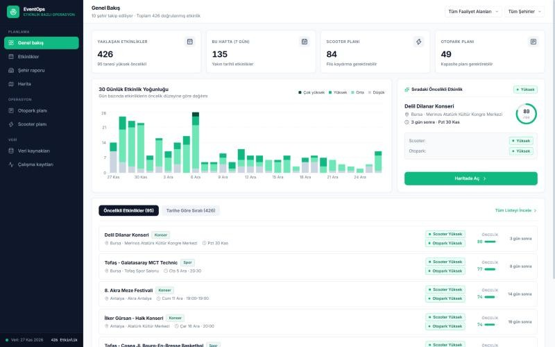
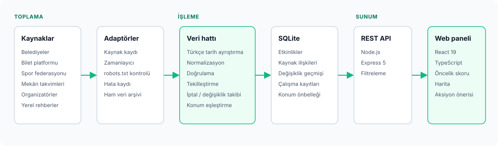

# EventOps

**Şehirdeki etkinlikleri, scooter ve otopark operasyonu için önceden alınacak kararlara dönüştüren veri platformu.**

EventOps; belediye takvimlerini, bilet platformlarını, spor federasyonlarını ve mekân sayfalarını düzenli olarak tarar. Bu dağınık bilgiyi tek ve doğrulanmış bir etkinlik akışına çevirir. Her etkinlik için operasyon ekibine aynı soruyu yanıtlar: **Bu etkinlikten önce filoda ve otoparkta ne hazırlanmalı?**

**[Canlı demoyu aç](https://rumeysabasaran.github.io/eventops-demo/)** · Salt okunur sürüm, 27 Kasım 2026 tarihli veri kopyasını kullanır.



| 10 şehir | 22 aktif kaynak | 426 doğrulanmış etkinlik | 58 çok kaynaklı kayıt |
| :---: | :---: | :---: | :---: |

*Rakamlar demodaki veri kopyasına aittir.*

## İş problemi

Paylaşımlı scooter işinde her araç bir maliyet kalemidir. Araçlar satın alınır, şarj edilir ve gün içinde bir yerden başka bir yere taşınır. Kullanılmadan bekleyen her scooter, bu maliyeti karşılığı olmadan taşır. Bu yüzden sektörün temel verimlilik göstergelerinden biri **scooter başına kullanım oranıdır.**

Kullanım oranını artırmanın yolu, aracı talebin oluşacağı yere talep oluşmadan önce götürmektir. Akademik çalışmalar da bu yeniden dağıtım kararının, geçmişin ortalamasına bakmak yerine gerçek veriye dayandığında daha iyi sonuç verdiğini gösteriyor ([Guan ve ark., 2024](https://research.chalmers.se/en/publication/543304)).

Talebi kısa sürede değiştiren etkenlerden biri şehirdeki etkinliklerdir. Bir konser, maç ya da fuar, birkaç saat içinde aynı bölgeye binlerce kişiyi toplar. Bu bilgi ise operasyon ekibinin elinde hazır değildir. Onlarca farklı sitede, farklı biçimlerde ve çoğu zaman eksik olarak durur.

## Çözüm

EventOps bu bilgiyi toplar, temizler ve karar verilebilir hale getirir.

1. **Toplar:** Her kaynak için ayrı bir adaptör, kaynağın kendi düzenine göre çalışır.
2. **Temizler:** Türkçe tarih biçimlerini ayrıştırır, kategorileri normalize eder, aynı etkinliği farklı kaynaklarda tanıyıp tek kayıtta birleştirir.
3. **Doğrular:** İptal, erteleme, tarih değişikliği ve kaynaklar arası çelişkileri kayıt altına alır.
4. **Önceliklendirir:** Her etkinliğe 0-100 arası bir öncelik skoru verir ve scooter ile otopark için ayrı aksiyon önerisi üretir.
5. **Gösterir:** Etkinliği, çevresindeki 800 metrelik planlama alanıyla birlikte haritada sunar.


## Operasyon ekibi ne kazanır?

- **Tek bakışta hafta planı:** Önümüzdeki 30 gündeki etkinlikler, öncelik düzeyine göre tek ekranda.
- **Somut aksiyon:** "Scooterları etkinlikten önce mekân çevresine kaydırın" ya da "otopark kadrosunu artırın" gibi doğrudan uygulanabilir öneriler.
- **Güvenilir veri:** Kaynak yayımlamadıysa mekân, saat veya katılım tahmin edilmez. Konumu bilinmeyen etkinlik için saha aksiyonu yerine "önce konumu doğrula" önerisi üretilir.
- **Şeffaflık:** Her etkinliğin hangi kaynaklardan geldiği, en son ne zaman doğrulandığı ve kaynaklar arasında çelişki olup olmadığı görünür.

## Etkinin ölçülmesi

Öncelik skoru bugün kural tabanlıdır ve **henüz gerçek sürüş verisiyle doğrulanmamıştır.** Sistemin değerini kanıtlamak için planlanan ölçüm:

| Gösterge | Soru |
| --- | --- |
| Scooter başına günlük sürüş | Etkinlik bölgesine önceden kaydırılan araçlar daha fazla kullanılıyor mu? |
| Etkinlik çevresinde boş araç oranı | Etkinlik çıkışında talep karşılanabiliyor mu? |
| Yeniden dağıtım maliyeti | Kaydırma operasyonu, ek sürüş gelirini karşılıyor mu? |
| Skor isabeti | Yüksek skor alan etkinliklerde talep gerçekten artıyor mu? |

Bu karşılaştırma, aynı türdeki etkinliklerde önceden hazırlık yapılan ve yapılmayan bölgelerin sürüş verisiyle yapılabilir.

## Teknik öne çıkanlar

- **Adaptör mimarisi:** Belediye, bilet platformu, spor federasyonu, mekân, organizatör ve yerel rehber kaynakları için ortak `EventSourceAdapter` sınıfı. Yeni kaynak eklemek tek bir sınıf ve bir kayıt satırıdır.
- **Zamanlayıcı:** Her kaynak kendi aralığında çalışır, günde bir kez tüm kaynaklar baştan taranır, etkinlikler 30 dakikada bir yeniden doğrulanır. Çökmüş bir kaynak diğerlerini durdurmaz.
- **Türkçe veri işleme:** `03 - 05 Eylül 2026`, `28.08.2026 | 10:00` gibi biçimleri ayrıştırma, İstanbul saat dilimiyle çalışma.
- **Tekilleştirme:** Başlık, tarih, şehir ve mekân benzerliğiyle kaynaklar arası eşleştirme. Demoda 58 etkinlik birden fazla kaynaktan birleştirilmiştir.
- **Değişiklik takibi:** Kaynaktan kaybolan, iptal edilen veya tarihi değişen etkinliklerin geçmişi saklanır.
- **Konum eşleştirme:** Mekân adları OpenStreetMap Nominatim ile koordinata çevrilir ve sonuçlar önbelleğe alınır.
- **Sorumlu veri toplama:** `robots.txt` kontrolü, Nominatim kullanım kurallarına uygun istek aralığı ve kaynak bazlı hata kaydı.
- **Güvenli demo:** Statik demo için veri ayrı bir adımda dışa aktarılır. Ham sayfa içeriği, kaynak notları ve görseller dışarıda bırakılır, açıklamalardaki telefon numaraları maskelenir.

## Mimari



| Katman | Teknoloji |
| --- | --- |
| Arayüz | React 19, TypeScript, Vite, Tailwind CSS, Recharts, Leaflet |
| API | Node.js, Express 5 |
| Veri toplama | Cheerio, kaynak bazlı adaptörler, zamanlayıcı |
| Veritabanı | SQLite (better-sqlite3, WAL) |
| Harita verisi | OpenStreetMap, Nominatim |

```
backend/
  scrapers/      Kaynak adaptörleri (belediye, bilet, spor, mekân, organizatör, haber)
  services/      Normalizasyon, doğrulama, tekilleştirme, konum eşleştirme
  jobs/          Zamanlayıcı, toplu tarama, demo dışa aktarma
src/
  pages/         Genel bakış, harita, şehir raporu, scooter ve otopark planı
  lib/impact.ts  Öncelik skoru ve aksiyon önerileri
```

## Öncelik skoru

Skor; etkinlik kategorisi, mekân türü, etkinlik ölçeği, gün ve saat ile kaynak sayısını kullanır (`src/lib/impact.ts`). Konser ve maç gibi kalabalık toplayan kategoriler, hafta sonu ve akşam saatleri, birden fazla kaynakta doğrulanan etkinlikler daha yüksek puan alır. Skor bir talep tahmini değildir, hangi etkinliğe önce bakılması gerektiğini sıralamak için kullanılır.

## Kurulum

Node.js 20 veya üzeri gerekir.

```bash
npm install
npm run server   # API, veri toplama ve zamanlayıcı (port 3001)
npm run dev      # Arayüz (port 5173)
```

| Komut | Açıklama |
| --- | --- |
| `npm run scrape` | Tüm aktif kaynakları bir kez çalıştırır |
| `npm run scrape -- biletix` | Tek bir kaynağı çalıştırır |
| `npm run build` | Tip kontrolü ve üretim derlemesi |
| `npm run build:demo` | Çalışan API'den veri alıp statik demo üretir (`dist/`) |

## Yol haritası

- [ ] Önerileri gerçek sürüş ve otopark verisiyle karşılaştırma
- [ ] Geçmiş sürüş verisiyle öğrenen talep modeli
- [ ] Operasyon ekibinin doğal dille soru sorabileceği LLM asistanı ("Bu hafta sonu Bursa'da filoyu nasıl hazırlamalıyız?")
- [ ] Mekân kapasitesi kataloğu
- [ ] Yüksek öncelikli etkinlikler için bildirim
- [ ] Otomatik testler ve CI

## Kaynakça

- Guan, Y., Tian, X., Jin, S., Gao, K., Yi, W., Jin, Y., Hu, X., & Wang, S. (2024). *Data-driven optimization for rebalancing shared electric scooters.* Electronic Research Archive, 32(9), 5377-5391. [Bağlantı](https://research.chalmers.se/en/publication/543304)
