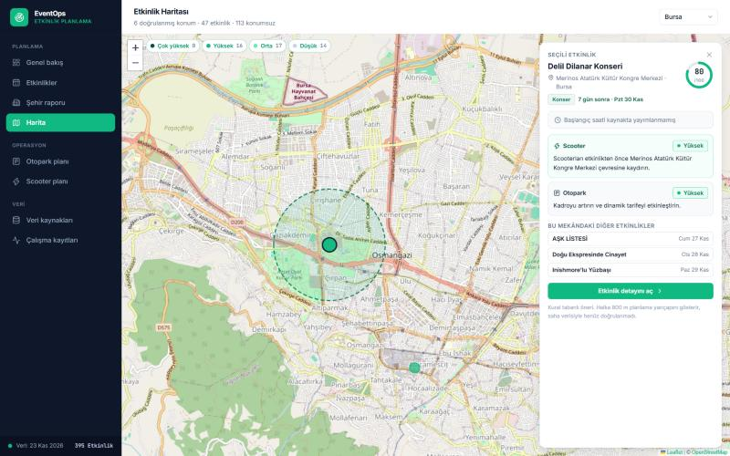

# EventOps

Şehirlerdeki konser, maç, festival ve fuarları kamuya açık kaynaklardan toplayan, temizleyen ve **mikromobilite ile otopark operasyonları için önceliklendirilmiş aksiyon önerilerine** dönüştüren full-stack web uygulaması.

**[Canlı demoyu aç](https://rumeysabasaran.github.io/eventops-demo/)** · Salt okunur sürüm, 23 Kasım 2026 tarihli veri kopyasını kullanır.


## Çözdüğü problem

Büyük bir etkinlik, çevresindeki scooter ve otopark talebini kısa sürede değiştirebilir. Bu bilgi ise belediye siteleri, bilet platformları, spor federasyonları ve mekân takvimleri arasında dağınık durur. EventOps bu kaynakları tek akışta birleştirir ve operasyon ekibine üç soruyu yanıtlar:

- **Ne zaman ve nerede** önemli bir etkinlik var?
- **Hangi hizmet** bundan etkilenebilir?
- **Etkinlikten önce** ne hazırlanmalı?



## Öne çıkanlar

- **Çok kaynaklı veri toplama:** 10 şehirde 22 aktif kaynak, kaynak türüne göre zamanlanmış çalışma ve `robots.txt` kontrolü.
- **Türkçe veri işleme:** `03 - 05 Eylül 2026`, `28.08.2026 | 10:00` gibi tarih biçimlerini ayrıştırma ve kategori normalizasyonu.
- **Kaynaklar arası tekilleştirme:** Aynı etkinliği başlık, tarih, şehir ve mekân benzerliğiyle tek kayıtta birleştirme.
- **Değişiklik takibi:** İptal, erteleme, tarih değişikliği ve kaynak çelişkilerini kayıt altına alma.
- **Veri dürüstlüğü:** Kaynağın yayımlamadığı mekân, saat veya katılım bilgisi tahmin edilmez. Konumu bilinmeyen etkinlik için saha aksiyonu üretilmez.
- **Operasyon ekranları:** Genel bakış, etkinlik haritası, şehir raporu, scooter ve otopark planı, kaynak sağlığı ve çalışma kayıtları.
- **Mobil uyumlu arayüz** ve API gerektirmeyen salt okunur demo sürümü.

## Mimari


| Katman | Teknoloji |
| --- | --- |
| Arayüz | React 19, TypeScript, Vite, Tailwind CSS, Recharts, Leaflet |
| API | Node.js, Express 5 |
| Veri toplama | Cheerio, kaynak bazlı adaptörler, zamanlayıcı |
| Veritabanı | SQLite (better-sqlite3) |
| Harita verisi | OpenStreetMap, Nominatim |

Yeni bir kaynak eklemek için `backend/scrapers/` altına `EventSourceAdapter` sınıfından türeyen bir adaptör yazıp `backend/registry.ts` dosyasına kaydetmek yeterlidir.

## Öncelik skoru

Her etkinlik 0-100 arası kural tabanlı bir öncelik skoru alır. Skor; kategori, mekân türü, etkinlik ölçeği, gün ve saat ile kaynak sayısını kullanır (`src/lib/impact.ts`).

> **Kapsam notu:** Skor bir talep tahmini değildir ve henüz gerçek sürüş ya da otopark verisiyle doğrulanmamıştır. Sıradaki adım, önerileri saha verisiyle karşılaştırıp etkisini ölçmektir.

## Kurulum

Node.js 20 veya üzeri gerekir.

```bash
npm install
npm run server   # API, veri toplama ve zamanlayıcı (port 3001)
npm run dev      # Arayüz (port 5173)
```

| Komut | Açıklama |
| --- | --- |
| `npm run scrape` | Tüm aktif kaynakları bir kez çalıştırır |
| `npm run scrape -- biletix` | Tek bir kaynağı çalıştırır |
| `npm run build` | Tip kontrolü ve üretim derlemesi |
| `npm run build:demo` | Çalışan API'den veri alıp statik demo üretir (`dist/`) |

## Yol haritası

- [ ] Önerileri gerçek sürüş ve otopark verisiyle karşılaştırma
- [ ] Mekân kapasitesi kataloğu
- [ ] Otomatik testler ve CI
- [ ] Yüksek öncelikli etkinlikler için bildirim
